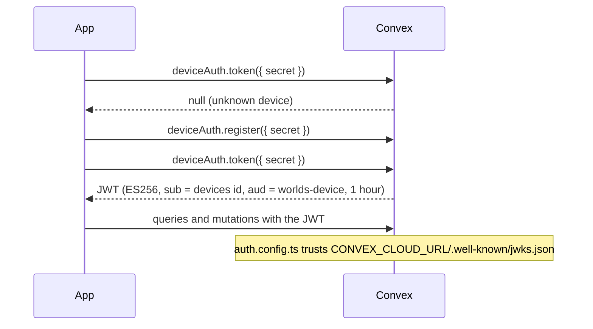

# Device profiles, friends and the shared feed: handoff

Branch `capy/device-profiles-friends` (YCCO-16 / DAN-14). It is merged with main up to worlds#5 (voice), so the record button and the `record` form sheet are kept.

## What works

- **Device profiles.** On first launch a phone picks a name. There's no password. The phone keeps a random 32-byte secret (SecureStore on iOS, localStorage on web), and Convex sees it as a signed-in user through `ctx.auth`.
- **Friends.** Each profile has an 8-character invite code, shown as `XXXX-XXXX`. A friend opens `worlds://invite/<code>` (on web, `/invite/<code>`) or types the code on the Friends screen. Friendships are mutual. A new phone that opens an invite link becomes friends as soon as it picks a name.
- **Sharing and the feed.** New worlds are private. Share and Unshare on your own world control whether friends see it. Home reads `feed.list`: your worlds plus your friends' shared worlds, newest first, 50 at most. It's a Convex query, so a share shows up on a friend's screen without a reload.
- **Per-person memory.** `worlds.add` saves the day to the owner's Supermemory space, `memorySpace(identity.tokenIdentifier)` in `convex/memory.ts`.

## How identity works

Convex (1.48 and later) signs the token with the deployment's own key through `ctx.auth.signJwt`. **No keys need setting up.** There's no `JWT_PRIVATE_KEY`, no JWKS env var and no key script. The earlier plan assumed RS256 keys in env vars; this replaces it.



- `devices` stores only `sha256(secret)`. `register` is idempotent and takes 32 to 256 characters.
- `tokenIdentifier` is `<CONVEX_CLOUD_URL>|<devices id>`. Everything per-person keys off it, as CREW.md asks.
- `compassionate-goose-961` already serves an ES256 key set at `https://compassionate-goose-961.convex.cloud/.well-known/jwks.json` (checked with curl, HTTP 200).
- The client is `src/profiles/DeviceProfileProvider.tsx`. It wraps the app in `ConvexProviderWithAuth`, exchanges the secret for a token over `ConvexHttpClient`, and gates the app: a spinner, then "Couldn't reach worlds" with Try again, then onboarding, then the app. The first sign-in retries after 1 and 4 seconds, then shows that error. A token refresh (hourly) keeps retrying every 10 seconds until the network is back, so a phone that goes offline stays in the app and keeps unsaved drafts, such as the record sheet's words.

## Data model and functions

| Table              | Fields                                                              | Indexes                                                         |
| ------------------ | ------------------------------------------------------------------- | --------------------------------------------------------------- |
| `worlds` (changed) | adds `ownerTokenIdentifier` (required) and `shared` (optional)      | `by_ownerTokenIdentifier`, `by_ownerTokenIdentifier_and_shared` |
| `devices`          | `secretHash`                                                        | `by_secretHash`                                                 |
| `profiles`         | `tokenIdentifier`, `name`, `inviteCode`                             | `by_tokenIdentifier`, `by_inviteCode`                           |
| `friendships`      | `tokenIdentifier`, `friendTokenIdentifier`, two rows per friendship | `by_tokenIdentifier_and_friendTokenIdentifier`                  |

Public functions are `deviceAuth.register` and `token`; `profiles.me` and `create({ name, inviteCode? })`; `friends.list`, `inviter({ code })` and `accept({ code })`; `sharing.share` and `unshare({ worldId })`, which are owner only; `feed.list`; and `worlds.list` and `worlds.add({ transcript })`. Those last two are now owner only, and `add` refuses a caller without a profile token.

## Before this deploys to compassionate-goose-961

`ownerTokenIdentifier` is required, so the push fails schema validation while the worlds that have no owner are still there (there were 3 when I last looked). The order is:

1. Clear the `worlds` table: in the dashboard, open Data, then `worlds`, select every row and delete them. This deletes data, so Danny should OK it.
2. Deploy as usual.
3. On a phone build, pick a name, add a world, and check the Convex logs for a clean `deviceAuth.token` call.

## What was checked, and how

- **`npx vitest run`: 21 tests pass.** `deviceAuth.test.ts` (3) covers a wrong secret, a deployment-signed token for a registered device, and a too-short secret. `friends.test.ts` (8) covers signed-out callers, invites (both directions, your own code, a code opened before picking a name, an unknown code), the shared filter for friends and strangers, and owner-only sharing. `memory.test.ts` (10) now runs as an owner. Deleting the shared filter, or the wrong-secret check, makes tests fail.
- **End to end against a local backend** (`CONVEX_AGENT_MODE=anonymous npx convex dev` plus a two-profile script):
  - an unknown secret gets a null token;
  - a real token works through `ctx.auth`;
  - a forged `alg=none` token is rejected;
  - an anonymous caller's feed is empty;
  - once Ana shares, Ben's feed shows her world;
  - `worlds.add` schedules `memory.remember`.
- **Two profiles on Expo web.** Two origins (`localhost:8081` and `127.0.0.1:8081`) give each profile its own localStorage. Ana picked a name and added a world, which showed "Only you can see this". Ben opened Ana's invite link and saw "Ana invited you". After he picked a name, it said "You and Ana are friends", and Ana's Friends list showed Ben without a reload. Ben's feed stayed empty until Ana tapped Share, then her world appeared in Ben's open tab without a reload. After merging main, home shows the Friends link, the share row and the Record your day button. Screenshots are in the Captain drive under `renders/YCCO-16/`.
- **A token refresh while offline (from the review of worlds#8).** I set the token lifetime to 30 seconds locally (not committed), typed a draft, and stopped the backend for 40 seconds. Before the fix, the app was replaced by "Couldn't reach worlds" and the draft was lost. After it, the draft stayed on screen, and once the backend was back it saved as Ana's world without a reload. Renders 10 to 12 show this.
- `npx tsc --noEmit` (after `npx expo customize tsconfig.json`, as CI does), `npx expo lint`, `npx -y expo-doctor` (20/20) and Prettier all pass.

## Not checked on iOS

Danny asked for local testing only, so nothing ran on an iPhone:

- whether the SecureStore secret survives app restarts;
- opening `worlds://invite/<code>` from another app (Messages, say), from a cold start and while running. The code is read with `useLinkingURL()` and applied when the profile is created, and the invite screen accepts it straight away for an existing profile, but neither path ran on iOS;
- the native share sheet for the invite link (web copies it to the clipboard);
- `ctx.auth.signJwt` on the shared deployment. Its JWKS is live, but the functions aren't deployed there yet.

## Left to do

- **The pipeline's memory recall.** Gurnoor's scene writer must recall from the owner's space: `memorySpace(world.ownerTokenIdentifier)`, not the shared one.
- **Unfriending, a new invite code, renaming yourself.** None of these exist yet.
- **More than 50 friends.** The feed and the Friends list read only the first 50 friendships (`MAX_FRIENDS` in `profiles.ts`). That's fine for now, but it needs paging if people collect more.
- **Losing the phone loses the profile.** Real sign-in (DAN-3) replaces device profiles later. Keep `ownerTokenIdentifier` as the key, and map each device's `tokenIdentifier` to the new account when that lands.

## Merging with other open work

- **worlds#6 (Neel's home and WorldCard redesign).** Keep `useQuery(api.feed.list)` rather than `worlds.list`. Feed items are `{ _id, _creationTime, transcript, shared, mine, authorName }`. Keep the author name on friends' worlds, Share/Unshare on your own (`api.sharing.share` and `unshare`), and the Friends entry in the header.
- **Gurnoor's pipeline (worlds#3 and `capy/gurnoor-3d-worlds`).** Their `convex/access.ts` reads a world without checking who's asking. `worlds.get` should allow the owner, or a friend when `shared` is true; see `feed.ts` and `profiles.ts` for the friendship lookup. `worlds.add` must keep setting `ownerTokenIdentifier` and the memory space. Their `http.ts` and `convex.config.ts` merge cleanly, because this branch adds neither. Their world fields (`status`, `title`, `caption`, `palette`, `imageUrl`, `modelUrl`, `error`) aren't touched here.
- **worlds#5 (voice)** is merged in. The record sheet's `worlds.add` call works because the whole stack sits behind the profile gate.

## Running it locally

```bash
CONVEX_AGENT_MODE=anonymous npx convex dev   # local backend; writes .env.local
npx expo start --web                         # Ana on http://localhost:8081, Ben on http://127.0.0.1:8081
npx vitest run
```

Note that `CI=1 npx expo start` turns off Metro's file watching, so restart it after switching branches.
